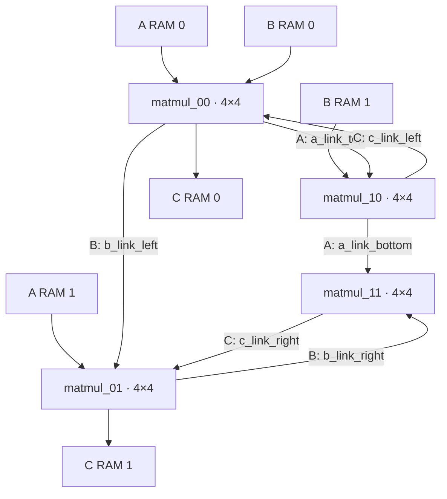

# Part 3 — 8×8 FP8 Systolic Matrix Multiplier

## Overview

This design forms an 8×8 systolic matrix multiplier from four existing 4×4 systolic blocks. The macro `MAT_MUL_SIZE` remains 4. Each block is positioned by its `a_loc` and `b_loc` values; the outer blocks receive matrix data from RAM, and the other block inputs receive the propagated systolic streams.



The lower blocks' C streams are shifted into the corresponding upper blocks. The upper blocks provide the two final C output streams. The RAM/control wrapper and testbench are not part of the synthesis top.

## Project files

- `RTL/matmul_8x8.sv` — 8×8 integration and completion control.
- `RTL/matmul.sv` — existing 4×4 systolic block and PE/data/output logic.
- `RTL/fp8_adder.sv`, `RTL/fp8_multiplier.sv` — FP8 arithmetic units.
- `RTL/matmul_with_ram.sv` — control wrapper and dual-bank RAMs for A, B, and C.
- `TESTBENCH/matmul_with_ram_tb.sv` — RAM initialization and simulation checks.
- `sim/Makefile` — VCS simulation and Verdi waveform targets.
- `synth/Makefile`, `synth/compile_dc.tcl` — Design Compiler flow for the 8×8 core.

## Simulation

From `PART3/sim`, run:

```sh
make run
```

The testbench runs two cases:

1. A and B contain all 1.0 values (`8'h30`); each expected C element is 8.0 (`8'h60`).
2. A contains all 0.5 values (`8'h20`) and B contains all 1.0 values (`8'h30`); each expected C element is 4.0 (`8'h50`).

The testbench checks C RAM addresses 0–7 in both output banks and verifies that no FP8 exception is asserted. Result mismatches terminate the simulation with `$fatal`.

To run the Verdi-enabled simulation and open its waveform, run `make waves_verdi` from `PART3/sim`. This produces `sim/matmul_8x8.fsdb`. An annotated waveform screenshot is a separate artifact; the FSDB itself is not an annotated screenshot. The waveform should show A/B RAM reads, forwarding between blocks, C data/address/write-valid activity, the initialized input RAM contents, and the final C RAM contents.

## Synthesis

The synthesis top is `matmul_8x8_systolic`. The source list includes the 8×8 wrapper, 4×4 implementation, and FP8 arithmetic dependencies; it excludes `matmul_with_ram.sv` and the testbench. The flow uses the FreePDK45 `gscl45nm` library and a 10 ns clock constraint (100 MHz), with 0.1 ns input/output delays, a 0.01 pF output load, and a 0.05 pF max-capacitance limit.

From `PART3/synth`, after sourcing `PART3/env.cshrc` in the configured Synopsys shell, run:

```sh
make synth
```

The latest successful synthesis run generated the mapped netlist, SDC, and reports in `synth/`.

| 8×8 synthesis metric | Result |
|---|---:|
| Clock target | 100 MHz (10 ns period) |
| Total mapped cell area | 234,814.720706 library area units |
| Mapped cells | 85,532 |
| Sequential cells | 2,803 |
| Worst slack among 10 reported paths | +1.746477 ns |
| Estimated dynamic power | 4.674300 mW |
| Estimated leakage power | 1.0950 mW |

Timing is pre-layout and uses an ideal clock and wire-load model. The power estimate has unannotated input and sequential activity, so it is indicative rather than workload-based.

### 4×4 and 8×8 comparison

The current synthesis reports document the 8×8 core. A matching 4×4 synthesis result using the same library and constraints is not available here, so a quantitative area/frequency comparison cannot yet be reported accurately.

| Design | Cell area (library area units) | Frequency constraint | Timing result |
|---|---:|---:|---|
| FP8 4×4 systolic | Not measured | — | — |
| FP8 8×8 systolic | 234,814.720706 | 100 MHz | +1.746477 ns worst reported slack |

The FreePDK45 library contains cells with zero-valued max-capacitance attributes, so Design Compiler may still report internal max-capacitance warnings for those cells. The previously generated reports used a 0.05 pF output load and contained 38 output/address-port violations against the 0.05 pF limit. The flow now models a 0.01 pF core-boundary output load while retaining the 0.05 pF max-cap limit; updated reports could not be generated in this environment because Design Compiler reported that its license was not enabled.

## Architecture calculations

### Peak read bandwidth

There are two 32-bit A RAM read banks and two 32-bit B RAM read banks. Assuming all banks transfer one word in the same cycle:

- A: 64 bits/cycle
- B: 64 bits/cycle
- Combined: **128 bits/cycle (16 bytes/cycle)**

At the 100 MHz clock target, this interface peak is 12.8 Gbit/s (1.6 GB/s).

### Peak write bandwidth

The two C RAM banks each accept a 32-bit word per cycle, giving a peak of **64 bits/cycle (8 bytes/cycle)**, or 6.4 Gbit/s (0.8 GB/s) at 100 MHz, assuming both banks write concurrently.

### Cycle count

The 8×8 completion counter advances for 33 active clock edges and asserts `done_mat_mul` on the next edge. Thus, the core's count from the start of its active counting window through the completion edge is **34 clock cycles**. This excludes the wrapper FSM startup before `start_mat_mul` becomes active.

### MAC count

An 8×8 product has 64 output elements, each formed from 8 multiply-accumulate operations:

$$8 \times 8 \times 8 = 512\ \text{MACs}$$
